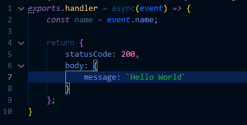
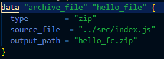
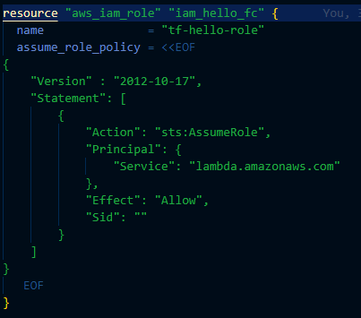
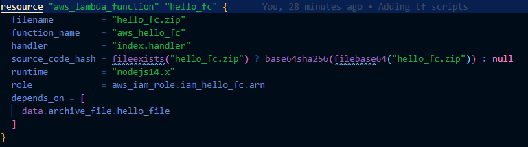
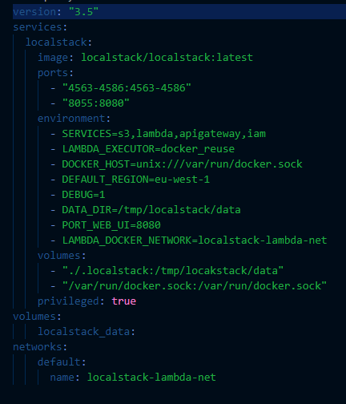

# Hello LocalStack

Hello reader! 😊

I've created this repository to let you know how does it feel to be Jeff Bezos, or something like that 🤣 because with this repository code you will have Amazon Web Services hosted in your local machine...
sounds crazy? (╯°□°）╯︵ ┻━┻

Well, first let me explain 🙂

In order to understand and be able to give it a look you'll need to (instead having a million of dollars or enough to pay an AWS account) :

* Docker basic knowledge

* Amazon Web Services understanding

* Maybe some Terraform or Infrastructure as Code

* And a smiling face 😝

I think that's it, let me know if I'm forgetting something ( ´･･)ﾉ(._.`)

Now, maybe you also could need a little of JavaScript, but the code part is done so let's start.

## Coding Part

Fort this exercise I created this small function:



This will be our "Hello World" code, and as you can see O(∩_∩)O

That's all the code we need 😁

### Well, not at all

We need to have installed **Docker**, **Terraform** and **aws cli** in order to be able to make something cool with our code.

Once you have those installed (or meanwhile gets installed) we can start writing our terraform scripts to create our AWS resources ヾ(≧▽≦*)o

## Terraform

Let's create a folder for our terraform scripts and start...

But first let's zip our code with a *file.tf*:



Now we need a **Role with a policy** for our lambda, we can just name this file as *iam.tf*:



Let's create our **AWS Lambda** function in our *lambda.tf*:



**Note that we are indicating to our lambda to read the file we created and also attached the role*

## Docker Compose

At this point we the installation should have been completed, and we can give a try for our **AWS local instance** (●ˇ∀ˇ●)

We need to create a compose file, let's keep it in the root to make easier to access:


This file contains the main ingredient for our **Amazon Local Instance**!

What we are doing here is basically indicate which AWS resources we're creating to emulate (because we are emulating AWS, we don't have a super powerful computer to have a real local instance 😢), and also some other important indications that will allow to execute the lambda locally 😁

Now it's matter to run **docker compose build**, go inside our terraform folder and run **terraform init**, **plan** and **apply** and just see how the magic happens...

Once the lambda gets created we can run:
aws lambda invoke --function-name aws_hello_fc --endpoint=<http://localhost:4566/> output.txt

Where "aws_hello_fc" is the name of our lambda and "output.txt" is the file where the lambda's output (duh 🤦‍♂️) will be write.

And that's how you can get Amazon Web services in your local machine 😊

I leaved some other stuffs (just an **API Gateway** integration with the lambda) there, you can give it a try if you want, but please **READ THE DOCUMENTATION** (´▽`ʃ♡ƪ)

Enjoy (￣y▽￣)╭ Ohohoho.....

 ༼ つ ◕_◕ ༽つ

## CI / Validation

This repo includes a GitHub Actions workflow that validates Terraform via two checks on every push to `main` and on pull requests:

- tflint — lints Terraform code for common issues and provider best-practices.
- conftest — runs Rego policies (in `policy/terraform`) against a Terraform `plan.json` file.

Notes / tips:
- The workflow looks for `terraform/plan.json` in the repository first. If not present, it attempts to run `terraform init` and `terraform plan` to generate a plan, then converts it to JSON for conftest. Generating a plan in CI may require provider credentials (AWS, etc.) and so can fail if those are not available.
- If your CI environment doesn't have provider credentials, either commit a generated `terraform/plan.json` into the repo, or configure your CI to supply credentials for plan generation.

Run the same checks locally:

1. tflint
```bash
brew install tflint        # macOS
cd terraform
tflint
```

2. conftest
```bash
# If you already have a plan.json in the repo:
conftest test terraform/plan.json --policy policy/terraform

# Or generate one locally (requires credentials for providers if necessary):
cd terraform
terraform init -backend=false
terraform plan -out=plan.tfplan
terraform show -json plan.tfplan > plan.json
conftest test ../plan.json --policy ../policy/terraform
```
